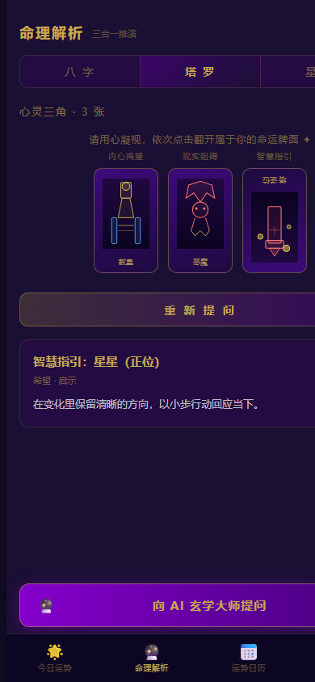
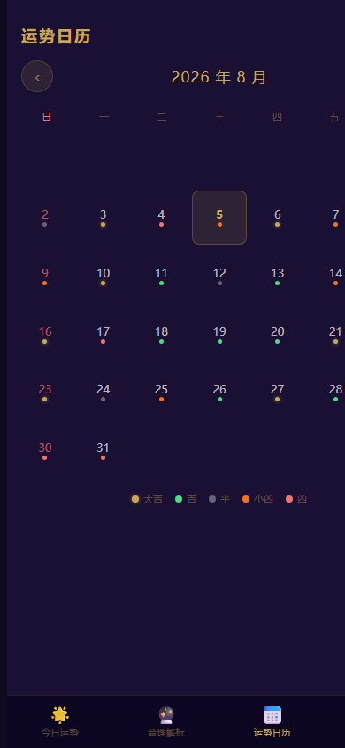

# Mystic Destiny · 命理星象


**东方命理 × 塔罗 × 星座的沉浸式 H5：深紫与金色的移动端交互体验，可选 AI 解读。**

> An immersive, browser-first H5 experience that brings Chinese astrology, tarot, daily fortune, and optional AI interpretation into one deep-purple-and-gold interface.

## Live experience / 在线体验

**[打开命理星象 →](https://xiaotian69.github.io/mystic-destiny/)**

桌面端与移动端浏览器均可访问；界面以手机竖屏体验为主。追加 `?intro=1` 可重播开场星尘动画。

| 能力 | 当前状态 |
| --- | --- |
| H5 页面（GitHub Pages） | ✅ 在线可访问 |
| 八字四柱、每日运势、签文、塔罗抽牌、星座、日历、成就 | ✅ 浏览器本地运行 |
| AI 塔罗解读与「AI 玄学大师」对话 | ⚙️ 依赖作者自建的 Cloudflare Worker 代理 DeepSeek；受额度与频率限制，可能不可用 |
| 微信小程序 | 🗂️ 历史原型，仅保留源码，不再维护 |

> 🔮 **娱乐声明**：命理、塔罗、星座与签文内容仅供娱乐和自我反思，不构成任何医疗、法律或财务建议。

## What it is / 项目简介

命理星象是一个原生 HTML、CSS 与 JavaScript 构成的单页 H5。它把八字四柱、每日五行运势、塔罗牌阵、星座提示与运势日历组织成一套沉浸式移动交互；核心推演与界面在浏览器内运行，AI 解读则通过可选的 Cloudflare Worker 接入 DeepSeek。

项目由早期微信小程序原型演进而来，当前在线体验入口是根目录的 `index.html`。

## Highlights / 核心体验

- **今日运势**：根据用户填写的生辰信息与当日干支，生成总分、事业、感情、财运、健康、宜忌和每日签文，并可生成竖版分享卡。
- **命理解析**：通过 `lunar-javascript` 计算四柱，提供 22 张大阿卡纳、1 / 3 / 5 / 7 张牌阵和十二星座提示。
- **运势日历**：以月历浏览每日色点；当前色点是前端生成的演示性标记，不是确定性预测数据。
- **本地进度**：生辰、连续访问、签文、塔罗收集和六项成就保存在浏览器 `localStorage` 中。
- **可选 AI**：开启塔罗牌阵会尝试自动解读，也可主动打开“AI 玄学大师”对话；未配置 Worker 时，其余本地体验仍可浏览。

## Screenshots / 界面展示

| 今日运势 | 塔罗牌阵 |
| --- | --- |
|  |  |

| 运势日历 | 运势分享卡（紧裁预览） |
| --- | --- |
|  |  |

截图使用合成生辰与合成提问采集，不包含个人资料或聊天记录。

## How it works / 工作方式

| 层级 | 行为 | 数据去向 |
| --- | --- | --- |
| 浏览器本地 | 路由、四柱与五行计算、运势、签文、星座、塔罗抽牌、日历、成就 | 页面内存与 `localStorage` |
| 外部前端依赖 | 从 jsDelivr 加载 `lunar-javascript`，用于四柱与干支计算 | 浏览器向 CDN 请求脚本 |
| 可选 AI | 塔罗自动解读与 AI 对话 | 浏览器 → 自建 Worker → DeepSeek API |
| 历史小程序原型 | `miniprogram/` 与示例云函数 | 不参与当前 H5 页面运行 |

GitHub Actions 将仓库中的静态内容发布到 GitHub Pages，不需要前端构建步骤。

## Local use / 本地运行

仓库没有 npm 构建流程。为避免 `file://` 环境的浏览器限制，推荐启动静态服务器：

```bash
git clone https://github.com/Xiaotian69/mystic-destiny.git
cd mystic-destiny
python -m http.server 8080
```

然后访问 `http://localhost:8080/`。也可直接打开 `index.html`；四柱计算仍需联网加载 jsDelivr 上的脚本，移动端本地文件模式会使用项目内置的表单 / iframe 兼容通道请求 AI。

## Optional AI setup / 可选 AI 接入

1. 在 Cloudflare Workers 创建服务，并部署 [`worker.js`](worker.js)。
2. 在 Worker 的 Secrets 中配置 `DEEPSEEK_API_KEY`；可选设置 `DEEPSEEK_MODEL`。源码默认使用 `deepseek-v4-flash`，并仅接受源码白名单中的模型名。
3. 将 [`index.html`](index.html) 中的 Worker 地址改为自己的部署地址：

```javascript
const DEEPSEEK_WORKER_URL = "https://your-worker.workers.dev";
```

API Key 只应保存在 Worker Secret 中，不要提交到仓库或写入前端。当前 Worker 允许跨域请求，并使用单实例内存计数做基础频率限制；公开部署前请按自己的威胁模型补充来源限制、鉴权、持久限流、配额和监控。

## Privacy, safety, and limitations / 隐私、安全与边界

- 生辰、访问记录、签文与成就默认保存在当前浏览器的 `localStorage`；可从“我的 → 清除本地数据”删除。
- 只有使用 AI 功能时，页面才会把当前提问及用于生成上下文的生辰、运势、星座或塔罗信息发送给所配置的 Worker 和 AI 服务商。请勿输入身份、健康、财务或其他敏感信息。
- 本项目的命理、星座、签文与塔罗内容仅用于娱乐和自我反思，不构成医疗、法律或财务建议，也不保证任何预测结果。
- 本项目为独立开源项目，与 DeepSeek、Cloudflare、GitHub、jsDelivr 或其他服务商不存在隶属或背书关系。第三方商标及名称归各自权利人所有。
- 农历数据、算法模板、随机日历色点与生成式模型输出都可能不完整或不准确；重要决定请依赖合格专业人士和可验证信息。

## Project structure / 项目结构

```text
.
├── index.html                         # 当前 H5：HTML / CSS / JS 单页应用
├── worker.js                          # 可选 DeepSeek Cloudflare Worker 代理
├── miniprogram/                       # 历史微信小程序原型
├── cloudfunctions/quickstartFunctions # 历史小程序示例云函数
├── docs/assets/                       # README 封面、社交预览与产品截图
└── .github/workflows/                 # GitHub Pages 发布工作流
```

## License

本项目使用 [MIT License](LICENSE)，Copyright © 2026 Xiaotian69。
